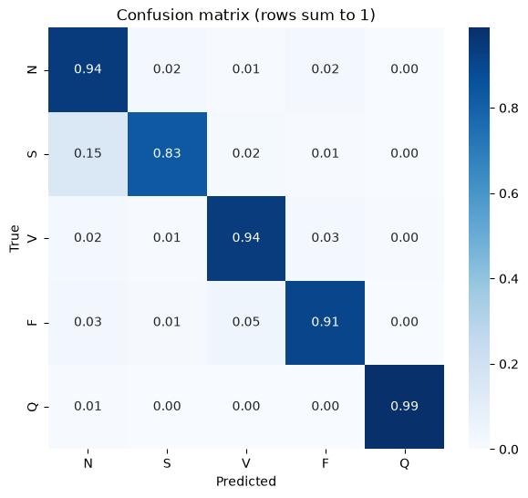

# ECG Classification

A 1D convolutional network that sorts single heartbeats from the MIT-BIH Arrhythmia Database into five classes.

**[See the project page →](https://ayush-yadav11.github.io/ECG-Classification/)** · [](https://colab.research.google.com/github/Ayush-yadav11/ECG-Classification/blob/main/ECG_classification.ipynb)


## Results

Scored once on the 21,892 beats of the test file: **94.34% accuracy**, macro F1 0.775.

| Class | Meaning | Recall | Precision | Test beats |
|---|---|---|---|---|
| N | Normal (bundle branch block included) | 94.4% | 99.2% | 18,118 |
| S | Supraventricular ectopic | 83.1% | 51.3% | 556 |
| V | Ventricular ectopic | 93.8% | 90.7% | 1,448 |
| F | Fusion | 90.7% | 23.5% | 162 |
| Q | Paced or unclassifiable | 98.8% | 96.9% | 1,608 |

Recall is high for every class. Precision is low for the rare classes: training resamples them to 20,000 beats each, so the network also calls some normal beats S (422) or F (437). The full numbers are in [`results/metrics.json`](results/metrics.json); the figures are in [`results/`](results/).



## What changed from the first version

The first version reached 60.93% on the test file. Three fixes:

1. **Noise.** Every training beat got Gaussian noise with σ = 0.5. Beats are scaled 0 to 1, so the noise buried the waveform. It is now σ = 0.05, a light augmentation.
2. **Early stopping.** It watched the test set; it now watches a 10% validation split of the training file, and the test set is scored once at the end.
3. **Labels.** Chart labels now follow the label order N, S, V, F, Q.

The network is unchanged: two convolution blocks (64 and 32 filters) and two dense layers (128 and 64 units) with dropout, 199,845 parameters. It trained for 19 epochs; the best was epoch 14.

## Run it

Open the notebook in Colab and run every cell: it downloads the data with `kagglehub`. Locally:

```bash
pip install -r requirements.txt
jupyter notebook ECG_classification.ipynb
```

Keras 3 runs on TensorFlow, PyTorch or JAX; set `KERAS_BACKEND` to the one you have. On a laptop CPU with the PyTorch backend it trained in about 25 minutes. The trained model is saved as `ecg_classification.keras`.

## Data

The [MIT-BIH Arrhythmia Database](https://physionet.org/content/mitdb/1.0.0/) on PhysioNet, cut into single beats (187 samples at 125 Hz, scaled 0 to 1) by Kachuee, Fazeli and Sarrafzadeh, *ECG Heartbeat Classification: A Deep Transferable Representation*, 2018, and shared on Kaggle as `shayanfazeli/heartbeat`: 87,554 training beats and 21,892 test beats.

This is a study project, not a medical device.

## Project structure

```
ECG_classification.ipynb   load, balance, train, evaluate, export (runs top to bottom)
ecg_classification.keras   the trained network
results/                   metrics.json and the notebook's figures
site/                      the project page (GitHub Pages) and its data/ecg.json
```

## Author

**Ayush Yadav** · [Portfolio](https://ayush-yadav.me/) · [GitHub](https://github.com/Ayush-yadav11) · [LinkedIn](https://www.linkedin.com/in/ayushyadav2611/)
